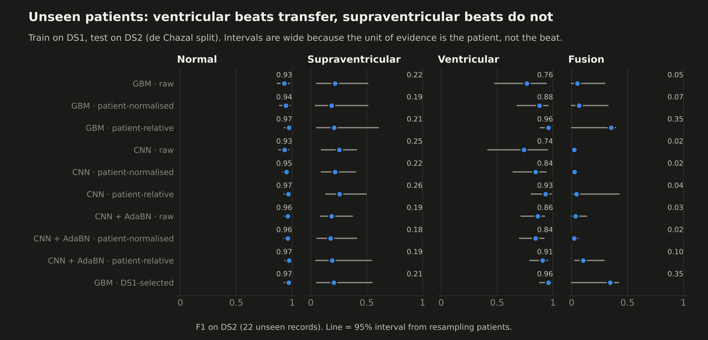
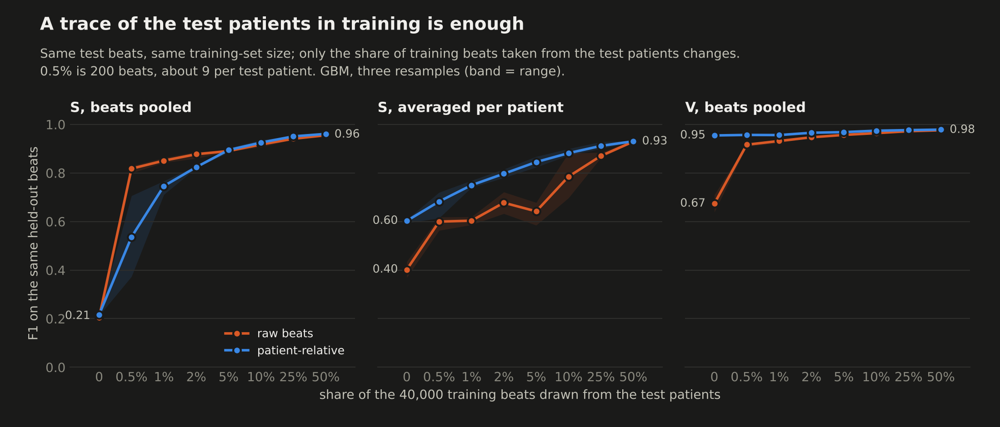
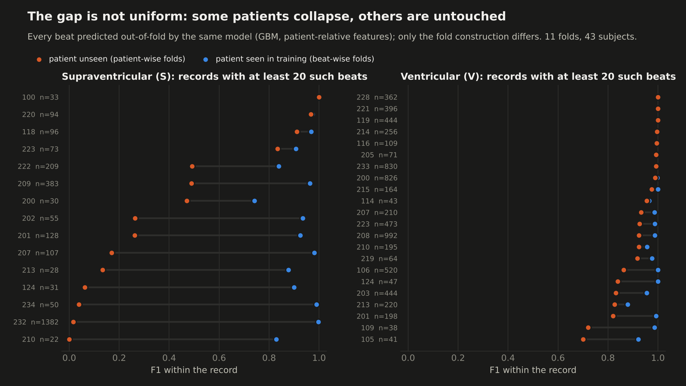
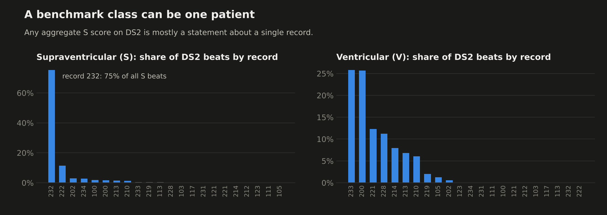

# ECG ShiftLab

Patient-independent cardiac arrhythmia classification on the MIT-BIH Arrhythmia Database.

**Question.** Can a machine learning model accurately distinguish cardiac arrhythmias in patients whose ECG recordings it has never encountered during training?

**Answer.** Partly, and the part that fails is hidden by the way this benchmark is usually scored.

- Ventricular ectopic beats transfer to unseen patients: F1 0.96 (95% CI 0.89 to 0.99) on 22 held-out records. In patient-wise cross-validation over the whole database, no patient with enough such beats to measure falls below 0.70.
- Supraventricular ectopic beats do not: F1 0.18 to 0.26 across every model and representation tried, with 11 of 15 patients below 0.5.
- The same models score 99.5% accuracy and macro-F1 0.96 when beats from the test patients are allowed into training. 200 such beats in a training set of 40,000 are enough to lift S-class F1 from 0.21 to 0.82.

Everything below is reproducible from this repository. Every number in the tables is printed from `results/*.json` by `scripts/make_tables.py`.

---

## 1. Unseen patients

Train on DS1 (22 records), test on DS2 (22 other records), the inter-patient partition of de Chazal et al. (2004). Four AAMI classes: N normal, S supraventricular ectopic, V ventricular ectopic, F fusion. Hyperparameters were fixed before DS2 was touched. Intervals come from resampling patients, not beats.



| Model | Representation | Accuracy | F1 N | F1 S [95% CI] | F1 V [95% CI] | F1 F |
|---|---|---|---|---|---|---|
| GBM | raw | 0.868 | 0.93 | 0.22 [0.05, 0.51] | 0.76 [0.48, 0.94] | 0.05 |
| CNN | raw | 0.875 | 0.93 | 0.25 [0.09, 0.41] | 0.74 [0.42, 0.95] | 0.02 |
| CNN + AdaBN | raw | 0.924 | 0.96 | 0.19 [0.09, 0.37] | 0.86 [0.71, 0.92] | 0.03 |
| GBM | patient-normalised | 0.892 | 0.94 | 0.19 [0.04, 0.51] | 0.88 [0.68, 0.96] | 0.07 |
| CNN | patient-normalised | 0.900 | 0.95 | 0.22 [0.09, 0.40] | 0.84 [0.64, 0.94] | 0.02 |
| CNN + AdaBN | patient-normalised | 0.926 | 0.96 | 0.18 [0.06, 0.41] | 0.84 [0.70, 0.92] | 0.02 |
| GBM | patient-relative | 0.944 | 0.97 | 0.21 [0.05, 0.60] | 0.96 [0.89, 0.99] | 0.35 |
| CNN | patient-relative | 0.936 | 0.97 | 0.26 [0.13, 0.50] | 0.93 [0.81, 0.99] | 0.04 |
| CNN + AdaBN | patient-relative | 0.943 | 0.97 | 0.19 [0.05, 0.54] | 0.91 [0.79, 0.95] | 0.10 |
| GBM | DS1-selected | 0.939 | 0.97 | 0.21 [0.05, 0.55] | 0.96 [0.88, 0.99] | 0.35 |

CNN rows are the ensemble of three seeds.

What moves the result is the representation, not the model family. Describing each beat relative to the patient's own median beat and own rhythm takes V from 0.76 to 0.96 with the same trees. Nothing moves S.

Accuracy is close to useless here. A model at 94% accuracy is missing more than four in five supraventricular beats.

## 2. How little leakage it takes

The test beats are fixed (a random half of every DS2 record). The training set is always 40,000 beats. The only thing that changes is how many of those 40,000 come from the other half of the test patients' records.



| Share from test patients | Beats | of which S | raw: S | raw: V | relative: S | relative: V |
|---|---|---|---|---|---|---|
| 0% | 0 | 0 | 0.21 | 0.67 | 0.22 | 0.95 |
| 0.5% | 200 | 7 | 0.82 | 0.92 | 0.54 | 0.96 |
| 1% | 400 | 14 | 0.85 | 0.93 | 0.75 | 0.96 |
| 2% | 800 | 27 | 0.88 | 0.95 | 0.82 | 0.97 |
| 5% | 2,000 | 70 | 0.89 | 0.96 | 0.89 | 0.97 |
| 10% | 4,000 | 143 | 0.92 | 0.96 | 0.93 | 0.97 |
| 25% | 10,000 | 349 | 0.94 | 0.97 | 0.95 | 0.98 |
| 50% | 20,000 | 710 | 0.96 | 0.98 | 0.96 | 0.98 |

About nine beats per test patient, seven of them supraventricular in total, quadruple the S-class score. A beat-level random split is the 50% row or worse. The CNN behaves the same way (S-class F1 0.26 to 0.95, patient-relative input).

Read the other way, this is a calibration budget: a handful of labelled beats from a new patient buys most of the gap. That is the practical route this project points to.

## 3. The gap is a per-patient phenomenon

Every beat in the database predicted out-of-fold, twice, by the same model. Once with folds made of whole patients, once with folds made of shuffled beats.



| Representation | Folds made of | Accuracy | Macro-F1 [95% CI] | F1 S | F1 V | F1 F |
|---|---|---|---|---|---|---|
| raw | whole patients | 0.903 | 0.51 [0.45, 0.56] | 0.28 | 0.76 | 0.03 |
| raw | shuffled beats | 0.994 | 0.95 [0.82, 0.97] | 0.95 | 0.98 | 0.87 |
| patient-relative | whole patients | 0.950 | 0.59 [0.51, 0.68] | 0.29 | 0.90 | 0.19 |
| patient-relative | shuffled beats | 0.995 | 0.96 [0.86, 0.97] | 0.96 | 0.99 | 0.88 |

- V, 22 patients with at least 20 such beats: median F1 0.93 unseen (minimum 0.70), 0.99 seen.
- S, 15 patients: median F1 0.26 unseen, 0.93 seen. Three patients are above 0.9 unseen; eleven are below 0.5.

## 4. Three problems with the benchmark itself

**One record owns the S class.** Record 232 holds 1,382 of the 1,837 supraventricular beats in DS2, 75%. Any pooled S score on DS2 is mostly a statement about that one patient. Every model here has S sensitivity between 0.00 and 0.14 on it.



Record 232 also breaks the assumption behind patient-relative features. 78% of its beats are supraventricular, so the patient's "typical beat" is the arrhythmia. A method that describes beats relative to the patient's dominant rhythm cannot see an arrhythmia that is the dominant rhythm.

**The standard split is not patient-independent.** Records 201 and 202 are the same subject. The de Chazal partition puts 201 in training and 202 in test.

| Representation | 201 in training | Accuracy on 202 | F1 S on 202 | F1 V on 202 |
|---|---|---|---|---|
| raw | yes | 0.904 | 0.58 | 0.82 |
| raw | no | 0.795 | 0.20 | 0.59 |
| patient-relative | yes | 0.989 | 0.86 | 0.89 |
| patient-relative | no | 0.731 | 0.07 | 0.55 |

Record 202 is small enough that the pooled DS2 numbers barely move, but for that patient the benchmark reports 0.86 where the honest figure is 0.07.

**Beats carry a patient signature.** A linear probe identifies which of 44 records a normal beat came from with 95.8% accuracy from waveform shape alone (chance 2.3%). Per-record amplitude normalisation leaves that at 94.8%. This is the mechanism behind sections 2 and 3: with shared patients, a classifier can recognise the person and recall their labels.

## 5. What did not help

- **Test-time BatchNorm re-estimation (AdaBN)** on each unseen record helped V on raw input (0.74 to 0.86) and lowered S in every setting. It is not a substitute for a patient-relative representation.
- **Model development done properly.** Six candidates (wider rhythm context, stronger regularisation, residual-only morphology, no waveform at all) were compared by patient-wise cross-validation inside DS1 only. Macro-F1 ranged from 0.528 to 0.544, inside the noise. The winner was evaluated on DS2 once: no change (last row of the first table). The S failure is not a tuning artefact of these model families.

## Method

- **Data.** MIT-BIH Arrhythmia Database v1.0.0, 44 records after removing the four paced ones (AAMI EC57), 100,679 beats, 43 subjects. Lead MLII only. Obtained here from a GitHub mirror of the PhysioNet release; all 704 files match the SHA-256 manifest shipped with it, and WFDB validates each signal against the checksum in its header.
- **Signal.** Zero-phase 0.5 to 40 Hz Butterworth. 700 ms window around each annotated R peak (250 ms before, 450 ms after).
- **Representations.**
  `raw`: amplitude in mV, RR intervals in seconds.
  `patient-normalised`: per-record amplitude scaling, RR intervals relative to the patient's local and median rhythm.
  `patient-relative`: the above plus the beat's deviation from the record's median beat.
  Per-record statistics use unlabelled signal only.
- **Models.** LightGBM on a decimated waveform plus rhythm features; a small 1D residual CNN (about 60k parameters) with late fusion of rhythm features. Fixed hyperparameters.
- **Statistics.** Cluster bootstrap over patients (2,000 resamples). A beat-level bootstrap would treat 50,000 correlated beats as independent and report intervals that are far too narrow.
- **Guards.** Every patient-wise split asserts subject disjointness in code before training.

## Limits

- One database, 43 people, one lab, recorded 1975 to 1979. The real test of distribution shift is another database (INCART, MIT-BIH Supraventricular). PhysioNet was not reachable from the environment this was built in; the pipeline is ready for it.
- Beat locations come from the cardiologist annotations, as in most of this literature. A deployed system would use a QRS detector and inherit its errors.
- The S-class result is a statement about these two model families under a rule of never tuning on the test patients. Feature-engineered systems in the literature report higher inter-patient S scores; the per-patient analysis here suggests checking how much of that rests on record 232.
- The fusion class has about 400 beats per partition from a handful of patients. Its numbers are indicative only.
- Per-record normalisation uses the whole record. A streaming system would use a trailing window or the first minutes.

## Where this goes next

1. Cross-database evaluation on INCART and SVDB, scored per patient.
2. Rhythm-level models. Supraventricular ectopy is defined by timing and P-wave behaviour across several beats; a single-beat window with a few RR ratios is the wrong unit.
3. Few-shot patient calibration, measured honestly: labelled beats from the first minutes of a record only, budget on the x-axis.
4. A template that survives abnormal dominant rhythms (record 232).

## Reproduce

```bash
pip install -r requirements.txt
python scripts/fetch_data.py                 # downloads MIT-BIH from PhysioNet, builds data/processed/beats.npz
python -m shiftlab.experiments all           # E1 to E5, about an hour on 2 CPU cores
python scripts/dev_ds1.py                    # DS1-only model selection
python -m shiftlab.experiments v2            # selected candidate on DS2, once
python scripts/make_figures.py
python scripts/make_tables.py
```

```
shiftlab/config.py        protocol constants: records, partitions, AAMI mapping
shiftlab/data.py          WFDB records to beat arrays
shiftlab/features.py      the three representations
shiftlab/models.py        GBM, CNN, AdaBN
shiftlab/metrics.py       per-class metrics, cluster bootstrap, per-patient averages
shiftlab/experiments.py   E1 benchmark, E2 leakage, E3 cross-validation, E4 201/202, E5 identity probe
results/                  JSON outputs behind every number above
```

## References

- de Chazal P, O'Dwyer M, Reilly RB. Automatic classification of heartbeats using ECG morphology and heartbeat interval features. IEEE Trans Biomed Eng. 2004;51(7):1196-1206.
- Moody GB, Mark RG. The impact of the MIT-BIH Arrhythmia Database. IEEE Eng Med Biol Mag. 2001;20(3):45-50.
- Goldberger AL, et al. PhysioBank, PhysioToolkit, and PhysioNet. Circulation. 2000;101(23):e215-e220.
- ANSI/AAMI EC57. Testing and reporting performance results of cardiac rhythm and ST segment measurement algorithms.
- Li Y, Wang N, Shi J, Liu J, Hou X. Revisiting batch normalization for practical domain adaptation. arXiv:1603.04779, 2016.

Data: MIT-BIH Arrhythmia Database, PhysioNet, Open Data Commons Attribution License v1.0. Not redistributed here.
